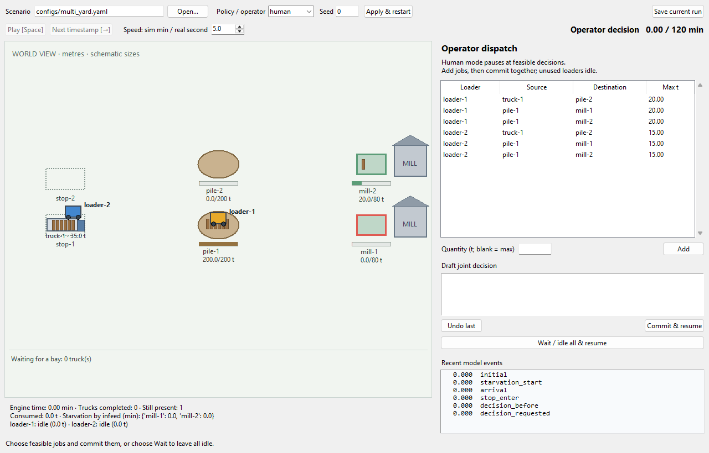
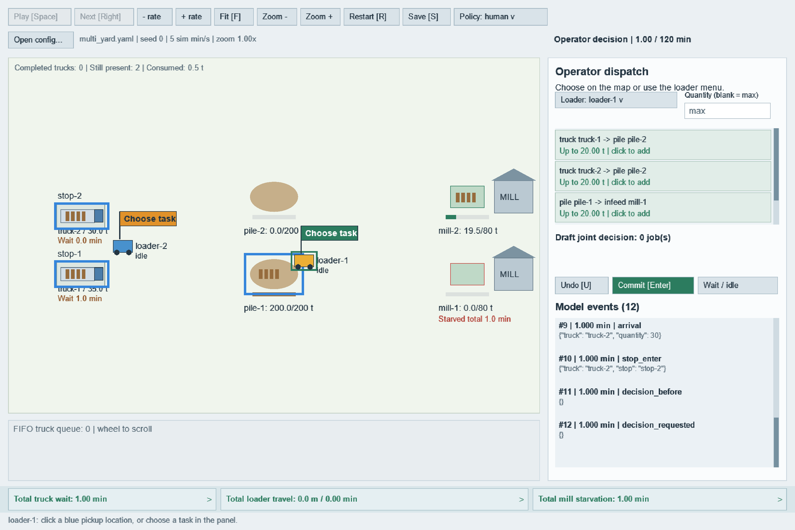
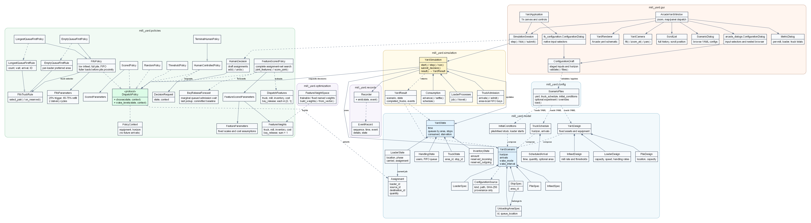

# mill-yard

A Python discrete-event simulation and decision-support toolkit for forestry mill-yard
operations. The current model compares dispatch policies under deterministic truck
arrivals and fixed mill demand. Stochastic inputs and optimization are planned.

## Setup

Install [uv](https://docs.astral.sh/uv/getting-started/installation/) and ensure
Python 3.12 or newer is available. The repository selects Python 3.12 by default;
if needed, uv can install it:

```powershell
uv python install 3.12
```

From the repository root, create the environment. For a development setup,
install all extras and development tools:

```powershell
uv sync --all-extras --group dev
```

For a basic installation without development tools or optional extras, use
`uv sync --no-dev` instead. The default desktop interface uses Tkinter from the
selected Python installation. The optional `gui` extra installs Arcade for the
alternative OpenGL interface (`uv sync --extra gui`).

Activate the environment using the command for your shell:

```powershell
.venv\Scripts\Activate.ps1       # Windows PowerShell
```

```bash
source .venv/bin/activate         # Linux or macOS
```

Then install the Git hooks:

```powershell
pre-commit install
```

The hooks run the configured Ruff checks on staged Python files. `uv.lock` records
the resolved dependency versions. You can also run project commands with `uv run`
without activating the environment.

## Commands

Run commands from the repository root. `uv run` uses the project environment;
if that environment is already activated, you can omit the `uv run` prefix.

### Run a scenario

```powershell
uv run mill-yard run configs/experiments/traffic/1area_shared__003trucks_1loader_180min.yaml
```

The positional argument selects an experiment preset. This example uses one
loader, two truck bays sharing one queue, one pile, and one infeed. The preset
references separate yard, truck-schedule, and initial-condition YAML files. The command runs through
the truck schedule's default `horizon` and prints completed and unfinished trucks,
truck waiting time, infeed consumption and starvation, and loader travel distance.
It uses the threshold policy by default.

To create another yard, edit/copy a file under `configs/yards/` and select a
compatible schedule from `configs/truck_schedules/` and starting state from
`configs/initial_conditions/`. An experiment under `configs/experiments/` records
that combination without duplicating the data. Times are in minutes, distances in metres, quantities in tonnes,
speeds in metres per minute, and handling and consumption rates in tonnes per
minute. The loader validates the scenario before the run starts.
`configs/experiments/traffic/` contains one- and two-loader scenarios with 3, 15,
or 45 trucks. The two-mill case is grouped under `configs/experiments/validation/`.
These examples are illustrative rather than calibrated.
`configs/experiments/queues/` adds independent unloading areas, each with its own FIFO queue
and one or more bays; trucks cannot move into another area's free bay.

You can select the three inputs directly and optionally override the horizon:

```powershell
uv run mill-yard run --yard configs/yards/3areas_central__6bays_4piles_1mill_3loaders.yaml --truck-schedule configs/truck_schedules/3areas_central__042trucks_waves_480min.yaml --initial-conditions configs/initial_conditions/3areas_central__6bays_4piles_1mill_3loaders__partial_stock.yaml --horizon 480 --policy fifo --validate
```

The same input options work with `gui`. In both desktop interfaces, **Inputs...**
stages the three selections and horizon override; **Apply & restart** starts the
validated combination. Invalid selections leave the current run intact. See
[configuration ownership, defaults, compatibility, and Python APIs](docs/configuration.md).
The [configuration catalog](configs/README.md) explains family prefixes, naming,
and retained/retired cases. The old 14-hour demo is archived; current examples use
descriptive names and keep the six traffic and four queue comparison cases.

### Choose a policy

```powershell
uv run mill-yard run configs/experiments/traffic/1area_shared__015trucks_2loaders_180min.yaml --policy threshold
uv run mill-yard run configs/experiments/traffic/1area_shared__015trucks_2loaders_180min.yaml --policy fifo
uv run mill-yard run configs/experiments/queues/2areas_travel__006trucks_alternating_120min.yaml --policy empty-queue-first
uv run mill-yard run configs/experiments/queues/2areas_uneven__012trucks_north_heavy_180min.yaml --policy longest-queue-first
uv run mill-yard run configs/experiments/traffic/1area_shared__015trucks_2loaders_180min.yaml --policy random --seed 42
uv run mill-yard run configs/experiments/traffic/1area_shared__015trucks_2loaders_180min.yaml --policy scored
uv run mill-yard run configs/experiments/traffic/1area_shared__015trucks_2loaders_180min.yaml --policy feature-scored
```

`--policy` selects `threshold`, `fifo`, `empty-queue-first`, `longest-queue-first`,
`random`, `scored`, `feature-scored`, or `human`. The random policy's seed
defaults to `0`; specify `--seed` to reproduce a particular sequence of random
choices. The scored policy has tunable weights; for example:

```powershell
uv run mill-yard run configs/experiments/traffic/1area_shared__015trucks_2loaders_180min.yaml --policy scored --truck-weight 3 --starvation-weight 100
```

Only the original `scored` policy uses the scored-weight options. See **Dispatch policies**
below for their interpretation and limitations. Supplying these options with a
different policy is rejected rather than silently ignored.

### Desktop viewer and operator

```powershell
uv run mill-yard gui configs/experiments/traffic/1area_shared__015trucks_2loaders_180min.yaml --policy scored --speed 5
uv run mill-yard gui configs/experiments/traffic/1area_shared__015trucks_2loaders_180min.yaml --human --validate
```

The first command watches an automated policy; the second lets you dispatch loaders.
`--policy human` is equivalent to `--human`. The window starts paused, with a schematic
map, inventory bars, loader phases, truck queue, and scrollable model events. Loader rectangles
interpolate along their routes during playback. Inventory between events is projected
for display; these animations do not modify the model or policy observations.

| Control | Behavior |
| --- | --- |
| Right arrow / Next timestamp | Pause and process the next simulation timestamp, including its same-time events. |
| Space / Play | Toggle continuous playback; speed is **simulation minutes per real second**. |
| Open / Apply & restart | Load a scenario or apply the selected policy and seed from time zero. |
| Inputs... | Select a yard, truck schedule, and initial conditions; validate together before applying. |
| Add / Undo last | Assemble a joint operator decision on a temporary reservation view. |
| Commit & resume | Validate and apply the draft, then play until the next operator decision. |
| Wait / idle all & resume | Assign nothing at this decision and continue to a later event. |
| Save current run | Save the committed state and recorded history under `runs/`; unfinished sessions are marked `partial`. |

In human mode, playback pauses whenever feasible work can be assigned. Select a
task row, optionally enter a smaller positive quantity, and click Add. Feasible
choices update after each addition so two assignments cannot overclaim the same
material or capacity. Add work for multiple loaders before committing; any unused
loader remains idle. Pickup, travel, deposit, and access-slot waits then execute
automatically. If no work is feasible, the simulation continues without prompting.

Backward stepping and loading saved runs into the viewer are not implemented yet;
the left arrow displays this limitation. Restart is a fresh run. A draft is not
part of a saved run until it has been committed. Closing the window does not
automatically save the session. GUI sessions retain records in
memory until saved (`--record events` by default); use `--record snapshots` for state
history or `--record summary` for minimal recording.



Tk and a graphical desktop are required. Check the selected interpreter with
`uv run python -m tkinter`. On Debian/Ubuntu with system Python, Tkinter is provided
by `python3-tk`; it must be installed for the Python interpreter uv actually uses.
The terminal simulation does not import Tkinter and still works without a display.

### Arcade viewer and operator

Both desktop interfaces use the same simulation session and dispatch logic. Tkinter
remains the default; select Arcade explicitly:

```powershell
uv sync --extra gui
uv run --extra gui mill-yard gui configs/experiments/traffic/1area_shared__015trucks_2loaders_180min.yaml --backend arcade --policy scored --speed 5
uv run --extra gui mill-yard gui configs/experiments/traffic/1area_shared__015trucks_2loaders_180min.yaml --backend arcade --human --validate
```

Scroll the mouse wheel over the yard to zoom around the pointer; drag with any mouse
button to pan. The **Zoom +/-** buttons also zoom, and **F / Fit** restores the full
yard. Right arrow steps one timestamp, Space toggles playback, and the rate buttons
halve or double simulation minutes per real second. Restart resets the run. Use the
**Policy dropdown** to select a policy directly; a different selection starts a new
run. **Open config...** opens a folder browser where you can choose a YAML scenario
or type its path. Opening a config starts a fresh run with the selected policy and
fits the view to the new yard. Invalid files leave the current run intact. These
menus pause playback; canceling resumes it if it was playing. The random seed is
set through the command line.

In human mode, click a loader with feasible work (or its **Choose task** flag).
Its feasible pickup locations are highlighted **blue**. Click a truck or pile to
select the pickup; it becomes **orange**, and feasible deposit locations are
highlighted **green**. Click a highlighted pile or infeed to add that transfer to
the draft. Escape clears the current pickup selection, then the loader selection.
Dragging pans the yard without selecting or assigning a task.

The side operator panel provides an independent alternative: choose a loader from
its dropdown, optionally enter a smaller quantity, then click a complete feasible
task. The quantity field applies to map selections too. Both interfaces build the
same joint decision draft. Repeat for other loaders and choose **Commit / Enter**
to apply the assignments together. **Undo / U** restores the last choice;
**Wait / idle** discards the draft and continues without assigning work. Simulated
time remains paused while decisions are pending. Loaders without feasible work
have no flag. Dropdowns also support Up / Down, Enter, and Escape.

Truck labels show cumulative waiting minutes, excluding pickup service. The bottom
panel totals wait for completed and still-present trucks, loader travel distance and
time, and starvation summed across infeeds. Counters include progress between model
events for display and agree with run metrics at event timestamps. Truck labels and
aggregate counters are also available in Tkinter.

In Arcade, starving mills display a red **Starved total** label with their cumulative
starvation minutes. The label disappears when material becomes available; the
accumulated time remains part of the totals. Click any bottom counter to open its
breakdown: starvation by mill / infeed, distance and travel minutes by loader, or
waiting minutes by truck (including completed and still-present trucks). The lists
support wheel scrolling, scrollbar dragging, arrow keys, Page Up / Down, and Home /
End. Playback pauses while inspecting a breakdown; Close, Enter, or Escape returns
to the yard and resumes playback if it was playing. Operator drafts are preserved.

**Model events** retains the complete recorded event list. Hover over it to scroll,
drag its scrollbar, or use Home / End to jump to the beginning / end. New events
follow automatically while viewing the end; scrolling up preserves the reading
position. The truck queue and long feasible-task lists also support wheel scrolling.
Event rows show brief details; saved JSON records contain the full payloads. With
`--record summary`, no event history is retained in either interface.



Arcade requires a graphical desktop and OpenGL 3.3 support. It is imported only for
`--backend arcade`; Tkinter and terminal runs do not require the optional dependency.
Save / S writes the committed run under `runs/`. Backward replay and opening saved
runs remain future work in both interfaces.

### Operate through the terminal

```powershell
uv run mill-yard run configs/experiments/traffic/1area_shared__003trucks_1loader_180min.yaml --policy human --save
```

At each feasible decision, enter a menu number to add a task, or a number followed
by a quantity, such as `2 10`. The menu is recalculated after each choice. Use
`undo`, `clear`, `done` to commit the draft, `wait` to idle, or `quit` to stop. Terminal
and GUI operator input are separate ways to run a session; the GUI does not also
read terminal commands. A stopped terminal run returns code 130 and leaves any
already streamed event records in its run directory.

### Control dispatch wake-ups

The scenario sets the wake-up mode and interval. These options override those
settings for one run:

```powershell
uv run mill-yard run configs/experiments/traffic/1area_shared__003trucks_1loader_180min.yaml --wake-mode interval --wake-interval 10
uv run mill-yard run configs/experiments/traffic/1area_shared__003trucks_1loader_180min.yaml --wake-mode policy
```

The first command uses a 10-minute fixed interval; the second uses the policy's
requested inventory crossings instead. Arrivals and other physical changes can
also trigger dispatch in either mode.

### Trace and save a run

```powershell
uv run mill-yard run configs/experiments/traffic/1area_shared__015trucks_2loaders_180min.yaml --policy random --seed 42 --trace
uv run mill-yard run configs/experiments/traffic/1area_shared__015trucks_2loaders_180min.yaml --policy scored --record events --save
```

`--trace` prints events live; `--trace-state` also prints the state at each
recorded event. `--record` selects the retained detail: `summary`, `events`, or
`snapshots` (the default). Add `--save` to write the run under a uniquely named
directory in `runs/`. The directory contains `metadata.json`, `summary.json`, and
`events.jsonl`; with `--record summary`, the event file is empty. The `runs/`
directory is ignored by Git.

Saved runs stream event records to disk as the simulation progresses, rather than
keeping the complete history in memory. Add `--validate` to check conservation,
capacities, reservations, payloads, and truck occupancy at model transitions:

```powershell
uv run mill-yard run configs/experiments/traffic/1area_shared__015trucks_2loaders_180min.yaml --policy scored --validate --save
```

### Compare examples and get help

```powershell
uv run python scripts/compare_traffic.py
uv run python scripts/compare_queues.py
uv run mill-yard run --help
```

The comparison script runs threshold, FIFO, scored, feature-scored, and seed-42 random policies on
each traffic scenario and prints CSV rows to the terminal. The help command lists
all CLI options and scored-policy parameter overrides.
The queue comparison runs FIFO, empty-queue-first, and longest-queue-first on
four multi-area examples, reporting waiting, tail wait, starvation, travel, and
unfinished trucks. See [queue configuration, rules, and results](docs/queue_policies.md).

For a longer run with central storage, use `configs/experiments/queues/3areas_central__042trucks_waves_480min.yaml`:
an eight-hour shift, three unloading areas, six bays, four central piles, three
loaders, and one mill on the west side.

## Repository layout

```text
mill-yard/
├── configs/
│   ├── yards/                 Fixed assets, geometry, capacities, equipment
│   ├── truck_schedules/       Arrivals and default horizon
│   ├── initial_conditions/    Starting inventories and loader positions
│   ├── experiments/           Reusable input combinations
│   ├── policies/              Dispatch rules and feature settings
│   └── optimization/          Trainable/fixed weight profiles
├── docs/                      Project and simulation documentation
├── scripts/
│   ├── compare_traffic.py     Compare five policies on traffic examples
│   └── compare_queues.py      Compare three operator policies across unloading areas
├── src/mill_yard/
│   ├── cli.py                 Command-line entry point
│   ├── config/                Strict YAML adapters and file selections
│   ├── model/                 Specifications, state, timing, feasibility, invariants
│   ├── simulation/
│   │   ├── engine.py          SimPy orchestration and dispatch coordination
│   │   ├── consumption.py     Analytical consumption and boundary scheduling
│   │   ├── loaders.py         Loader travel and handling phases
│   │   ├── trucks.py          Area-specific arrival routing and bay admission
│   │   └── result.py          Run result data
│   ├── policies/              Threshold, queue heuristics, random, scored, and human dispatch
│   ├── records/               Event recording, summaries, persistence
│   ├── evaluations/          Pure metrics, including unfinished work
│   ├── optimization/          Trainable/fixed weight spaces; search methods planned
│   └── gui/                   Tkinter/Arcade frontends, shared session, map controls
├── tests/                     Simulation and policy behavior tests
├── pyproject.toml             Package, dependencies, and tool settings
└── uv.lock                    Resolved dependencies
```

## Architecture

Independent `YardDesign`, `TruckSchedule`, and `InitialConditions` inputs compose
into a `YardScenario`. The multi-location model builds a `YardState` and
passes that state to a dispatch policy. The simulation checks the returned
assignments for feasibility, runs their phases using SimPy, and records the result.
The diagram groups the main classes by their package directory and shows their
relationships in this execution path.



The [DOT source](docs/uml.dot) can be rendered with Graphviz:

```powershell
dot -Tpng -Gdpi=150 docs/uml.dot -o docs/images/uml.png
```

`DispatchPolicy` in `policies/base.py` is a structural Python protocol; policies do
not inherit from it. Policies receive a copied `YardState` and a `PolicyContext`
with equipment and operating settings, excluding the future arrival schedule.
Automated policies return assignments; the nonblocking human policy returns a
`DecisionRequest` that the GUI resolves through the engine's submission API.
`model/scenario.py` defines immutable inputs, while `model/state.py` holds mutable
physical state. `model.feasibility` generates candidates and validates assignment sets. The CLI and
`config.loader` are adapters around the same Python API:

```python
from mill_yard.config.loader import load_yard_scenario
from mill_yard.policies.scored import ScoredPolicy
from mill_yard.simulation.engine import run_yard

scenario = load_yard_scenario("configs/experiments/traffic/1area_shared__003trucks_1loader_180min.yaml")
result = run_yard(scenario, ScoredPolicy(), record="events")
print(result.state.starvation, result.completed_trucks)
```

## Simulation model

All quantities are in tonnes, time in minutes, and coordinates and travel in metres.

Trucks enter their unloading area's FIFO queue and occupy the next free stop in
that area. Legacy configurations default to one shared `main` area. A truck leaves
its stop when its last material is picked up. Multiple loaders can handle the
same truck subject to the stop's handling limit. Each job reserves source material
and destination capacity, then travels to the source, waits for a handling slot,
picks up material, travels to the destination, waits for a slot, and deposits it.
Pile and infeed handling limits apply to the actual handling phase. The loader
is committed to its destination after pickup. Travel uses straight-line distances;
material on loaders is included in conservation accounting. Handling-slot queues
use SimPy's FIFO order. Equal-time arrivals use truck ID and free stops use the
order listed in the scenario. All ordinary events at a timestamp are processed
before dispatch, with events at the inclusive horizon included.
Physical updates and truck admissions at the horizon are included, but no new
loader jobs start at the horizon.

Each infeed consumes at its own fixed rate while stock is available; unmet demand
is lost and starvation time is recorded. Dispatch wakes at a **fixed interval by
default** (`wake_interval` in minutes, default 5), as well as at arrivals and
other physical changes. With `wake_mode: policy` or `--wake-mode policy`, the
policy can instead request inventory crossing levels. The built-in policies ask
for each infeed's low threshold. Low crossings and depletion are recorded in both
modes. A short fixed interval creates more decisions and can change policy behavior.

## Dispatch policies

The threshold policy prioritizes refilling low infeeds toward their targets, then
unloads the oldest stopped truck. The random policy selects sequentially from
feasible choices using its seed. Both return joint assignments; the engine validates
the full set on a copy before committing reservations. A custom policy may produce
a joint assignment without using the sequential baselines. Neither baseline is a
globally optimal assignment solver.

The `fifo` policy is an operator-style baseline: replenish low infeeds first,
relieve full piles next, then unload trucks in arrival order. It permits partial
loads and parallel service of later trucks once all older material is reserved.
It chooses the nearest eligible idle loader, then prefers the largest feasible
transfer before pile proximity. A 25% trigger starts replenishment toward 65%,
with a cycle-coverage adjustment and normal refill ceiling of 75%. Full-pile
relief can use spare infeed capacity above that ceiling. See the
[FIFO rules, edge cases, and comparison results](docs/fifo_policy.md).

```powershell
uv run mill-yard run configs/experiments/traffic/1area_shared__015trucks_2loaders_180min.yaml --policy fifo --fifo-config configs/policies/fifo.yaml --validate
```

The FIFO configuration contains fixed baseline rules rather than optimization
weights. Both GUI policy menus include `fifo`; saved metadata retains its settings.

`empty-queue-first` and `longest-queue-first` share these mill/pile priorities and
accept the same `--fifo-config`. The former keeps a per-loader area preference
until its unreserved truck work is cleared. The latter selects the largest
unreserved truck count, breaking ties by longest accumulated wait, oldest arrival,
then area ID. All ties are deterministic. Both menus support these policies and
area-specific queue views. See [configuration, exact rules, and comparisons](docs/queue_policies.md).

The `scored` policy compares complete feasible joint assignments for small fleets,
including idling, against one original observation. Truck benefit increases with
waiting and queue pressure. Refill benefit combines target deficit with predicted
starvation avoided over a common `lookahead` horizon. Incoming deliveries enter
that prediction at their estimated completion times. Travel and delivery duration
are penalized; a slow loader receives no extra urgency simply for being slow.
Canonical loader ordering makes results independent of the order of loader entries
in YAML. Estimates share timing rules with execution but exclude future handling-slot
waits. It considers maximal feasible quantities capped at target; it does not search
all continuous quantities. Enumeration still grows quickly with fleet and yard size.

The separate `feature-scored` policy searches complete feasible assignment sets
using five features: truck urgency, mill urgency, pile inventory balance,
operating cost, and bay-release benefit. It preserves the original `scored` policy. Features
account for committed work and the combined effects of each assignment set; the
mill feature corrects the proposal's slower-loader bonus. Per-assignment features
are bounded, and joint scores avoid double-counting shared benefits. Default weights are illustrative, not
optimized. See the [proposal review, equations, corrections, and verification](docs/feature_scored_policy.md).

```powershell
uv run mill-yard run configs/experiments/traffic/1area_shared__015trucks_2loaders_180min.yaml --policy feature-scored --feature-config configs/policies/feature_scored__v4_5weights.yaml --feature-weights 0.2 0.35 0.1 0.15 0.2 --save
```

The five feature weights are ordered truck, mill, inventory, cost, bay_release and
must sum to one. Four CLI values remain valid and set bay release to zero.
Version 4 combines individual wait, local backlog, and the area's longest
nonservice wait inside truck urgency (effective default shares 60%, 20%, 20%).
`truck_area_wait_share` and `area_wait_reference` configure the area component.
Bay release estimates
queued admission wait saved by final pickups, jointly accounting for commitments.
The default config fixes its weight at zero; `feature_scored__v4_5weights.yaml` enables it.
`legacy/feature_scored__v3_4weights.yaml` / `legacy/feature_scored__v3_5weights.yaml` reproduce version 3;
`legacy/feature_scored__v2_4weights.yaml` reproduces version 2. Named trainable/fixed profiles in
`configs/optimization/` can exclude the fifth variable from a future optimizer.
The YAML file separates those optimization variables from fixed references,
mixing coefficients, demand-coverage settings, and cost assumptions. Both GUI
policy menus also offer `feature-scored`.

```powershell
uv run --extra gui mill-yard gui configs/experiments/queues/3areas_central__042trucks_waves_480min.yaml --backend arcade --policy feature-scored --feature-config configs/policies/feature_scored__v4_5weights.yaml --record snapshots --validate
uv run python scripts/compare_feature_profiles.py
```

Original scored weights and reference times are `ScoredParameters` fields and can be passed
to `ScoredPolicy` in Python or overridden via `--truck-weight`, `--queue-weight`,
`--refill-weight`, `--starvation-weight`, `--travel-weight`, `--wait-reference`,
`--travel-reference`, `--assignment-penalty`, `--lookahead`, and `--delivery-weight`. Saved
run metadata includes these values. The original urgency formula was replaced
following review; previous tuning results do not validate this new scoring rule.
Defaults are starting values, not optimized policy parameters. The six scenarios
share one pile, two bays, and one infeed, with one or two loaders and 3, 15, or 45
trucks. Arrivals occur over 120 minutes in a 180-minute horizon. Waiting in the
comparison script includes waiting accrued by trucks still present at the horizon;
their eventual waiting and overtime are not known.

## Results and records

Truck wait means time from arrival to final pickup minus the union of actual pickup
intervals, including waits between pickups; completed truck time excludes subsequent
loader travel and deposit. Summaries separately report unfinished truck wait so far,
per-loader travel distance/time (including partial travel at the horizon), consumed
material, and starvation. Work remains unfinished at the horizon; overtime clearing
is not simulated.
Metrics additionally expose remaining truck material, onboard material, active job
count, and estimated outstanding loader minutes. These estimates exclude future
access-slot waits and do not constitute an overtime or terminal-cost objective.

`--trace` prints structured event details live; `--trace-state` adds state snapshots.
`--record summary`, `events`, or `snapshots` selects how much history is retained;
snapshots are the default. `--save` writes timestamped unique folders under ignored
`runs/`, with versioned metadata, summary JSON, and JSON Lines records. Snapshots
are copies at modeled events and decisions; continuously changing inventory between
events is reconstructed from the consumption rate. Starvation transitions are
evaluated after same-time physical updates, avoiding false interruptions when a
deposit coincides with depletion. Snapshot records include ordered handling queues,
the next arrival index, effective consumption boundaries, and policy memory at
decision points. Individual physical-event snapshots may be intermediate states;
decision snapshots represent settled observations.

The CLI streams saved events; the Python API retains history by default and supports
`events_path=...` with `retain_events=False`. Output schema version 4 records the
policy parameters, effective random seed, Python/SimPy versions, and source Git
revision/dirty status. `model.yard` and `policies.joint` remain compatibility imports;
new code should use the dedicated scenario, state, and policy modules.
Schema 4 snapshots contain `queues` by area and truck `area_id`; summaries retain
the aggregate queue and add per-area counts and waiting metrics. Older saved files
are not rewritten.
Saved metadata also records `configuration_sources` with file roles, absolute
paths, and SHA-256 hashes, alongside the authoritative resolved scenario.
These records do not yet implement restoring or branching a SimPy run; ordered
queues and policy memory improve inspection but do not serialize all SimPy runtime
machinery. Uncommitted source contents are not archived.

The examples are illustrative rather than calibrated. Stochastic supply and demand,
species, the entrance scale, optimization, and backward replay remain future work.
See [the model contract and limits](docs/model_assumptions.md) for the current
physical assumptions, decision semantics, and checkpoint limitations.
