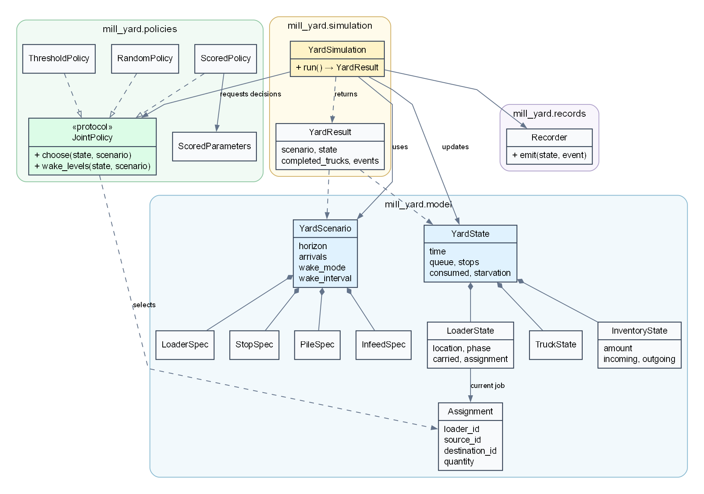

# mill-yard

A Python discrete-event simulation and decision-support toolkit for forestry mill-yard
operations. The current model compares dispatch policies under deterministic truck
arrivals and fixed mill demand. Stochastic inputs and optimization are planned.

## Setup

Install [uv](https://docs.astral.sh/uv/getting-started/installation/) and ensure
Python 3.12 or newer is available. The repository selects Python 3.12 by default;
if needed, uv can install it:

```powershell
uv python install 3.12
```

From the repository root, create the environment. For a development setup,
install all extras and development tools:

```powershell
uv sync --all-extras --group dev
```

For a basic installation without development tools or optional extras, use
`uv sync --no-dev` instead. The `gui` extra is currently optional.

Activate the environment using the command for your shell:

```powershell
.venv\Scripts\Activate.ps1       # Windows PowerShell
```

```bash
source .venv/bin/activate         # Linux or macOS
```

Then install the Git hooks:

```powershell
pre-commit install
```

The hooks run the configured Ruff checks on staged Python files. `uv.lock` records
the resolved dependency versions. You can also run project commands with `uv run`
without activating the environment.

## Commands

Run commands from the repository root. `uv run` uses the project environment;
if that environment is already activated, you can omit the `uv run` prefix.

### Run a scenario

```powershell
uv run mill-yard run configs/example.yaml
```

The required argument is the path to a YAML scenario. This example uses one
loader, one truck stop, one pile, and one infeed. The command runs through the
scenario's `horizon` and prints a summary of completed and unfinished trucks,
truck waiting time, infeed consumption and starvation, and loader travel distance.
It uses the threshold policy by default.

To create a different yard, copy an example YAML file and edit its settings. The
scenario lists truck arrivals, stops, piles, infeeds, loaders, and their locations
and capacities. Times are in minutes, distances in metres, quantities in tonnes,
speeds in metres per minute, and handling and consumption rates in tonnes per
minute. The loader validates the scenario before the run starts.
`configs/multi_yard.yaml` shows multiple assets; `configs/traffic/` contains
one- and two-loader scenarios with light, medium, and heavy truck traffic. These
examples are illustrative rather than calibrated.

### Choose a policy

```powershell
uv run mill-yard run configs/multi_yard.yaml --policy threshold
uv run mill-yard run configs/multi_yard.yaml --policy random --seed 42
uv run mill-yard run configs/traffic/medium_2loader.yaml --policy scored
```

`--policy` selects `threshold`, `random`, or `scored`. The random policy's seed
defaults to `0`; specify `--seed` to reproduce a particular sequence of random
choices. The scored policy has tunable weights; for example:

```powershell
uv run mill-yard run configs/traffic/medium_2loader.yaml --policy scored --truck-weight 3 --starvation-weight 100
```

Only the scored policy uses the scored-weight options. See **Dispatch policies**
below for their interpretation and limitations.

### Control dispatch wake-ups

The scenario sets the wake-up mode and interval. These options override those
settings for one run:

```powershell
uv run mill-yard run configs/example.yaml --wake-mode interval --wake-interval 10
uv run mill-yard run configs/example.yaml --wake-mode policy
```

The first command uses a 10-minute fixed interval; the second uses the policy's
requested inventory crossings instead. Arrivals and other physical changes can
also trigger dispatch in either mode.

### Trace and save a run

```powershell
uv run mill-yard run configs/multi_yard.yaml --policy random --seed 42 --trace
uv run mill-yard run configs/traffic/medium_2loader.yaml --policy scored --record events --save
```

`--trace` prints events live; `--trace-state` also prints the state at each
recorded event. `--record` selects the retained detail: `summary`, `events`, or
`snapshots` (the default). Add `--save` to write the run under a uniquely named
directory in `runs/`. The directory contains `metadata.json`, `summary.json`, and
`events.jsonl`; with `--record summary`, the event file is empty. The `runs/`
directory is ignored by Git.

### Compare examples and get help

```powershell
uv run python scripts/compare_traffic.py
uv run mill-yard run --help
```

The comparison script runs the threshold, scored, and seed-42 random policies on
each traffic scenario and prints CSV rows to the terminal. The help command lists
all CLI options and scored-policy parameter overrides.

## Repository layout

```text
mill-yard/
├── configs/                   Example yard and traffic scenarios
├── docs/                      Project and simulation documentation
├── scripts/
│   └── compare_traffic.py     Compare the three dispatch policies
├── src/mill_yard/
│   ├── cli.py                 Command-line entry point
│   ├── config/                YAML scenario loading
│   ├── model/                 Scenario, state, assignments, feasibility
│   ├── simulation/
│   │   └── engine.py          Multi-location SimPy simulation
│   ├── policies/              Threshold, random, and scored dispatch
│   ├── records/               Event recording, summaries, persistence
│   ├── optimization/          Placeholder for future optimization
│   └── gui/                   Placeholder for a future interface
├── tests/                     Simulation and policy behavior tests
├── pyproject.toml             Package, dependencies, and tool settings
└── uv.lock                    Resolved dependencies
```

## Architecture

The multi-location model loads a `YardScenario`, builds a `YardState`, and
passes that state to a dispatch policy. The simulation checks the returned
assignments for feasibility, runs their phases using SimPy, and records the result.
The diagram groups the main classes by their package directory and shows their
relationships in this execution path.



The [DOT source](docs/uml.dot) can be rendered with Graphviz:

```powershell
dot -Tpng -Gdpi=150 docs/uml.dot -o docs/images/uml.png
```

`JointPolicy` is a structural Python protocol; policies do not inherit from it.
`model.feasibility` generates candidates and validates assignment sets. The CLI and
`config.loader` are adapters around the same Python API:

```python
from mill_yard.config.loader import load_yard_scenario
from mill_yard.policies.scored import ScoredPolicy
from mill_yard.simulation.engine import run_yard

scenario = load_yard_scenario("configs/example.yaml")
result = run_yard(scenario, ScoredPolicy(), record="events")
print(result.state.starvation, result.completed_trucks)
```

## Simulation model

All quantities are in tonnes, time in minutes, and coordinates and travel in metres.

Trucks enter a central FIFO queue and occupy the next free stop. A truck leaves
its stop when its last material is picked up. Multiple loaders can handle the
same truck subject to the stop's handling limit. Each job reserves source material
and destination capacity, then travels to the source, waits for a handling slot,
picks up material, travels to the destination, waits for a slot, and deposits it.
Pile and infeed handling limits apply to the actual handling phase. The loader
is committed to its destination after pickup. Travel uses straight-line distances;
material on loaders is included in conservation accounting. Handling-slot queues
use SimPy's FIFO order. Equal-time arrivals use truck ID and free stops use the
order listed in the scenario. All ordinary events at a timestamp are processed
before dispatch, with events at the inclusive horizon included.

Each infeed consumes at its own fixed rate while stock is available; unmet demand
is lost and starvation time is recorded. Dispatch wakes at a **fixed interval by
default** (`wake_interval` in minutes, default 5), as well as at arrivals and
other physical changes. With `wake_mode: policy` or `--wake-mode policy`, the
policy can instead request inventory crossing levels. The built-in policies ask
for each infeed's low threshold. Low crossings and depletion are recorded in both
modes. A short fixed interval creates more decisions and can change policy behavior.

## Dispatch policies

The threshold policy prioritizes refilling low infeeds toward their targets, then
unloads the oldest stopped truck. The random policy selects sequentially from
feasible choices using its seed. Both return joint assignments; the engine validates
the full set on a copy before committing reservations. A custom policy may produce
a joint assignment without using the sequential baselines. Neither baseline is a
globally optimal assignment solver.

The `scored` policy compares feasible joint assignments for small fleets, including
idling. Truck urgency increases with accumulated waiting and queue length; infeed
urgency increases with deficit and estimated shortage risk. Travel is penalized.
It considers incoming material with a known or estimated deposit completion, not
as immediately available stock. Its delivery estimate excludes handling-slot
queues and treats active jobs before deposit conservatively. It evaluates maximal
feasible transfers, capped at the infeed target, rather than every possible transfer
quantity. Joint enumeration grows quickly with the number of assets and loaders.

Scored weights and reference times are `ScoredParameters` fields and can be passed
to `ScoredPolicy` in Python or overridden via `--truck-weight`, `--queue-weight`,
`--refill-weight`, `--starvation-weight`, `--travel-weight`, `--wait-reference`,
`--travel-reference`, and `--min-score`. Saved run metadata includes these values.
Defaults were hand-tuned on the deterministic `configs/traffic/` examples; they
are starting values, not optimized or validated policy parameters. The six scenarios
share one pile, two bays, and one infeed, with one or two loaders and 3, 15, or 45
trucks. Arrivals occur over 120 minutes in a 180-minute horizon. Waiting in the
comparison script includes waiting accrued by trucks still present at the horizon;
their eventual waiting and overtime are not known.

## Results and records

Truck wait means time from arrival to final pickup minus the union of actual pickup
intervals, including waits between pickups; completed truck time excludes subsequent
loader travel and deposit. Summaries separately report unfinished truck wait so far,
per-loader travel distance/time (including partial travel at the horizon), consumed
material, and starvation. Work remains unfinished at the horizon; overtime clearing
is not simulated.

`--trace` prints structured event details live; `--trace-state` adds state snapshots.
`--record summary`, `events`, or `snapshots` selects how much history is retained;
snapshots are the default. `--save` writes timestamped unique folders under ignored
`runs/`, with versioned metadata, summary JSON, and JSON Lines records. Snapshots
are copies at modeled events and decisions; continuously changing inventory between
events is reconstructed from the consumption rate. Events are currently accumulated
in memory and written after the run. These records do not yet support restoring or
branching a SimPy run from a snapshot. Git revision and dirty status are recorded,
but uncommitted source contents are not archived.

The examples are illustrative rather than calibrated. Stochastic supply and demand,
species, the entrance scale, optimization, and a GUI remain future work.
