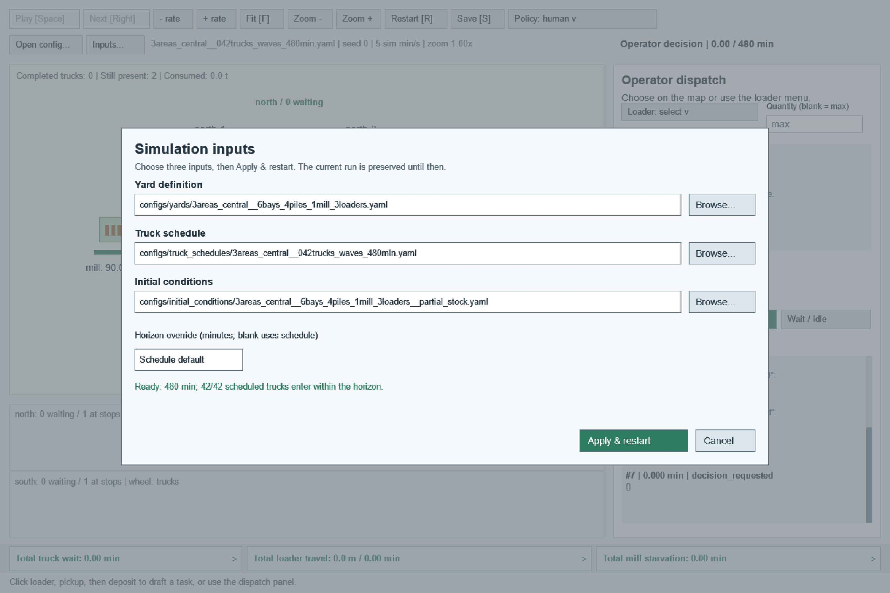

# Composing simulation inputs

The configuration library separates independent experimental choices. YAML is
read by adapters in `mill_yard.config`; the simulation receives one immutable,
fully resolved `YardScenario`. Typed inputs and their pure composition function
live in `model/configuration.py`. No simulation process opens input YAML files.

## File ownership

| Input | Owns | Does not own |
| --- | --- | --- |
| `kind: yard` | Unloading areas, bays, pile/infeed locations and capacities, handling limits, loader characteristics, fixed mill rates and infeed thresholds | Truck arrivals, horizon, starting stock, loader starting positions |
| `kind: truck_schedule` | Truck IDs, times, quantities, optional area IDs, default horizon | Asset geometry or initial inventory |
| `kind: initial_conditions` | Pile/infeed starting amounts and loader positions | Equipment capacities, consumption rates, arrival schedule |
| `kind: experiment` | References to the three inputs; optional horizon/wake overrides | Duplicated asset or arrival definitions, policy selection |

All four new file kinds require `schema_version: 1`. This input schema is separate
from output record schema 4 and from feature-policy definition versions. Files
are UTF-8 YAML mappings. Unknown fields, duplicate keys, wrong file kinds, and
unsupported schema versions are errors. Shared material/species compatibility is
future work: the present model still supports one homogeneous material, and
species fields are rejected rather than silently ignored.

An experiment preset looks like:

```yaml
kind: experiment
schema_version: 1
yard: ../../yards/3areas_central__6bays_4piles_1mill_3loaders.yaml
truck_schedule: ../../truck_schedules/3areas_central__042trucks_waves_480min.yaml
initial_conditions: ../../initial_conditions/3areas_central__6bays_4piles_1mill_3loaders__partial_stock.yaml
wake_mode: interval
wake_interval: 5
```

These paths are relative to the preset's directory. The example is stored under
`configs/experiments/queues/`. Opening a preset loads all three referenced inputs;
it does not require changing the working directory to that folder.

## Component examples

A minimal yard definition:

```yaml
kind: yard
schema_version: 1
stops:
  - {id: bay, location: {x: 0, y: 0}, max_loaders: 2}
piles:
  - {id: pile, location: {x: 100, y: 0}, capacity: 200}
infeeds:
  - {id: mill, location: {x: 300, y: 0}, capacity: 60, consumption_rate: 1, low: 15, target: 40}
loaders:
  - {id: loader, capacity: 20, speed: 60, pickup_rate: 5, deposit_rate: 5}
```

Its truck schedule:

```yaml
kind: truck_schedule
schema_version: 1
horizon: 480
arrivals:
  - {id: truck-1, time: 0, quantity: 30}
```

Its initial conditions:

```yaml
kind: initial_conditions
schema_version: 1
piles:
  - {id: pile, amount: 40}
infeeds:
  - {id: mill, amount: 30}
loaders:
  - {id: loader, location: {x: 0, y: 0}}
```

Quantities are tonnes, time is minutes, and coordinates/distances are metres.
Loader speed is metres/minute; handling and consumption rates are tonnes/minute.

## Compatibility and defaults

- Without explicit unloading areas, the yard has the legacy `main` area.
  Named areas must have at least one stop, and stops must reference known areas.
- A schedule may omit `area_id` only when the selected yard has exactly one area;
  composition assigns that sole area, even if it is named something other than
  `main`. Multiple areas require each arrival's explicit, valid `area_id`.
  Explicit unknown IDs are never silently rerouted. Multiple bays in one area
  still share a single queue and do not require separate arrival destinations.
- All loader starting positions are required. Referencing an unknown loader,
  pile, or infeed is an error. Omitted pile/infeed amounts default to zero.
- Initial quantities must be finite, nonnegative, and no greater than capacity.
  Changing capacity during optimization does not silently clip starting stock.
- The schedule supplies the horizon. An experiment may override it; CLI
  `--horizon` overrides that value. In the GUI, the override field starts with
  the preset/CLI override; clearing it selects the schedule's horizon.
- Arrivals beyond the effective horizon remain in the resolved schedule but do
  not enter the run. An arrival exactly at the horizon is included, with no new
  loader task started there. The GUI reports how many arrivals enter within H.
- Wake defaults are `interval` and five minutes, unless the preset/CLI supplies
  overrides. CLI wake overrides persist while selecting other GUI inputs.
- Short supply, full piles, starvation, and unfinished trucks are valid outcomes,
  rather than compatibility errors.

Initial-condition files currently define stock and idle loader positions. They
are not saved-runtime checkpoints and cannot initialize active jobs or truck
queues. Loader starts remain unconstrained by roads/site bounds beyond finite
coordinates, consistent with the current straight-line travel model. A future
layout optimizer will need additional physical design constraints.

## CLI and GUI

Run a preset:

```bash
uv run mill-yard run configs/experiments/queues/3areas_central__042trucks_waves_480min.yaml --policy fifo --validate
```

Or select components independently:

```bash
uv run mill-yard run --yard configs/yards/3areas_central__6bays_4piles_1mill_3loaders.yaml --truck-schedule configs/truck_schedules/3areas_central__042trucks_waves_480min.yaml --initial-conditions configs/initial_conditions/3areas_central__6bays_4piles_1mill_3loaders__partial_stock.yaml --horizon 480 --policy fifo --validate
```

Use `gui` instead of `run` with the same input arguments. For Arcade, add
`--backend arcade` and install/select the `gui` extra as described in the README.
An experiment path and component flags cannot be combined; incomplete selections
are rejected. The policy YAML flags retain their existing meanings.

Both frontends have an **Inputs...** button. Pick the yard, truck schedule, and
initial conditions, optionally enter a horizon override, then choose
**Apply & restart**. Each Browse button checks the selected file's kind. The
complete selection is checked together; invalid combinations display an error
and prevent applying. Edits do not alter the current simulation. Apply constructs
and validates the replacement before closing the previous session; Cancel keeps
the previous session and resumes playback if it was playing. A new run starts
paused with the currently selected policy.



Tk also accepts typed paths. Arcade lets you click a path field and replace it,
or browse folders with the existing YAML chooser; Escape returns from a nested
browser to the selection dialog. **Open config...** / **Open...** still opens a
complete experiment preset or a legacy combined scenario. Restart reloads the
selected component files and starts fresh; opening the preset again rereads its
file references. No combination file is required for ad hoc GUI selections.

## Python and optimization

```python
from mill_yard.config.loader import (
    load_initial_conditions, load_truck_schedule, load_yard_design,
)
from mill_yard.model.configuration import compose_scenario
from mill_yard.policies.fifo import FifoPolicy
from mill_yard.simulation.engine import run_yard

yard = load_yard_design("configs/yards/3areas_central__6bays_4piles_1mill_3loaders.yaml")
initial = load_initial_conditions("configs/initial_conditions/3areas_central__6bays_4piles_1mill_3loaders__partial_stock.yaml")
schedule = load_truck_schedule("configs/truck_schedules/3areas_central__042trucks_waves_480min.yaml")
scenario = compose_scenario(yard, schedule, initial)
result = run_yard(scenario, FifoPolicy(), validate=True)
```

`YardDesign`, `TruckSchedule`, and `InitialConditions` are independent validated,
immutable inputs. An optimizer can construct/replace them directly, reuse one
yard for many schedules, or vary geometry against a fixed schedule. Composition
performs no file I/O. Create a fresh policy and simulation for each independent
evaluation. Stable area/asset IDs are necessary when reusing schedules and initial
conditions across design variants; changing topology may require an explicit
routing/initial-condition mapping in a future extension.

`ScenarioFiles` describes a file-backed selection; `select_scenario_files(...)`
supports a preset or three paths, and `.load()` resolves it. The legacy
`load_yard_scenario(path)` API remains available and now accepts experiment presets
as well as combined YAML. Direct construction of `YardScenario` remains supported.

## Saved runs and migration

Saved metadata contains the fully resolved `scenario` and a separate
`configuration_sources` list of input roles, absolute source paths, and SHA-256
hashes. An experiment contributes four sources; a direct component selection
contributes three; legacy combined YAML contributes one. Pure in-memory composition
can have no file sources. Provenance does not participate in physical scenario
equality and is not exposed in the restricted policy context.

The resolved definition is authoritative for replay/reproduction: source files
may subsequently change, and source hashes do not archive the original YAML.
This adds metadata without changing physical event/snapshot schema 4.

All twelve bundled combined scenarios were migrated under `configs/experiments/`.
Old `configs/example.yaml`, `configs/multi_yard.yaml`, `configs/traffic/`, and
`configs/queues/` paths have moved; existing external combined YAML still loads.
The traffic examples now share two fleet-specific yards and three supply schedules.
Migration checks preserved every resolved physical definition and all twelve FIFO
event streams, including the eight-hour central yard. Policy and optimization
configuration files remained separate from this scenario migration.

The subsequent naming cleanup uses family prefixes such as `1area_shared` and
`3areas_central`. Schedules add truck count, pattern, and horizon; initial
conditions use the exact yard stem plus stock condition. See the
[configuration catalog](../configs/README.md) for the convention and family index.
Eleven presets remain active. The original three-truck, 14-hour demonstration now
resides in `configs/archive/legacy_single_bay_14h/`, with its components together.
The two-mill case remains under `experiments/validation/`. Legacy feature profiles
are under `policies/legacy/`. All 12 physical definitions and FIFO event streams
were preserved; only names, references, and discovery groups changed. No obsolete
alias files are left in active directories.
