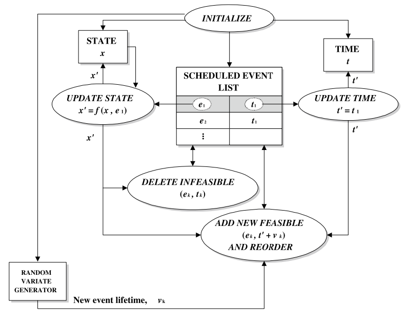

# Discrete-Event Simulation

This document introduces the discrete-event system and simulation concepts used to develop the `mill-yard` package. The theory follows Cassandras and Lafortune [1]; the SimPy discussion draws on its documentation and introductory resources [2–4].

## Discrete-event systems

A **system model** describes the behaviour of a system within a chosen boundary. Its **state** captures the information needed to describe its future evolution given future inputs. System theory uses such models to study behaviour, including prediction, performance, control, and estimation.

A continuous-time model can describe state changing continuously through an equation such as $\dot{x}(t)=F(x(t),u(t),t)$. In a **discrete-event system**, events trigger state transitions. Events may occur at irregular, real-valued times; an event is instantaneous, whereas an activity between its start and completion takes time [1].

A simple event-driven model can be written as

$$
x_{k+1}=f(x_k,e_k), \qquad e_k\in\Gamma(x_k),
$$

where $x_k$ is the state after event $k$, $e_k$ is the next event, $\Gamma(x_k)$ is the set of feasible events, and $f$ is the transition rule. A timed model also specifies when events occur, using schedules, fixed durations, or probability distributions.

Real-valued inventory amounts can be part of a discrete-event model if they change only at events. A hybrid model also allows variables to evolve continuously between events, such as continuously consumed infeed inventory [1].

## Discrete-event simulation

A simulation generates a sequence of event times and state changes—a **sample path**. A typical next-event simulator stores future events in an event calendar, advances the simulation clock to the earliest event, updates the state, and repeats.

For example, a transfer starting at time 0 may finish at time 10. If a truck arrives at time 4, the simulator handles that arrival at time 4 while the transfer is still in progress. Scheduling the completion does not skip intervening events.

### Event-scheduling and process-oriented schemes

In the **event-scheduling scheme**, model logic is organized around event types. An arrival event, for example, updates the queue and may schedule a service completion. Figure 10.1 shows the event-scheduling workflow in [1].



*Figure 10.1, reproduced from [1, p. 597]. Copyright © 2021 Springer Nature Switzerland AG.*

The simulator initializes the state, clock, and event list; removes the earliest event; advances time; updates the state; and revises the event list, including invalidating events that are no longer feasible. It then repeats until a stopping condition is reached. Input distributions supply random durations when required; separate data collection and reporting produce performance measures.

In the **process-oriented scheme**, logic follows a component through activities and waits. A customer, for example, arrives, waits for a server, receives service, and leaves. Event scheduling is useful when explicit state transitions are the clearest representation; process orientation is useful when sequences of activities and resource waits are easier to follow.

These are ways to organize a model. Either can represent the same system behaviour under equivalent assumptions. Process-oriented frameworks commonly use an event calendar underneath: a process yields control while it waits, and the scheduler resumes it when the relevant event occurs.

## SimPy

[SimPy](https://simpy.readthedocs.io/en/latest/) is a Python framework for process-oriented discrete-event simulation [2]. Its environment maintains simulation time and schedules events. Processes are typically written as Python generator functions: `yield env.timeout(duration)` pauses one process until its timeout occurs while other scheduled processes continue.

SimPy also provides shared resources, including `Resource` for limited-capacity servers, `Container` for bulk quantities, and `Store` for Python objects. The modeller supplies model logic and can use other packages for distribution sampling, statistical analysis, and visualization. The [introductory SimPy talk](https://www.youtube.com/watch?v=Bk91DoAEcjY) provides further context [3].

### A simple queue

This finite example models three customers arriving at three-minute intervals and sharing one server. Service takes five minutes [4].

```python
import simpy


class QueueSystem:
    def __init__(self, env):
        self.env = env
        self.server = simpy.Resource(env, capacity=1)
        self.waits = []

    def customer(self, customer_id):
        arrival = self.env.now
        with self.server.request() as request:
            yield request
            self.waits.append(self.env.now - arrival)
            print(f"Customer {customer_id} starts at {self.env.now}")
            yield self.env.timeout(5)

    def arrivals(self):
        for customer_id in range(1, 4):
            yield self.env.timeout(3)
            self.env.process(self.customer(customer_id))


env = simpy.Environment()
system = QueueSystem(env)
env.process(system.arrivals())
env.run()
print("Waiting times:", system.waits)  # [0, 2, 4]
```

The second customer arrives at time 6 while the first is still being served. It waits until time 8. The `with` block releases the resource after service. The arrival process is finite, so `env.run()` ends when no scheduled events remain; a model with an infinite arrival process needs an explicit stopping condition.

### Useful tutorial examples

The [intro-open-sim repository](https://github.com/pythonhealthdatascience/intro-open-sim/tree/main/content) [4] includes examples relevant to the yard:

- `02_basic_simpy.ipynb` and `04_111_model.ipynb`: processes, arrivals, and waiting for shared resources.
- `05_basic_results.ipynb`: recording waiting times and other run results.
- `07_experiments.ipynb`: replications and common random numbers for comparing scenarios.
- `09_time_weighted_calcs.ipynb`: time-weighted queue length and resource utilization.
- `11_blocking.ipynb`: example concerns holding one resource while waiting for another, potentially relevant to a truck occupying a receiving bay while waiting for a loader.

## Mill-yard discrete-event system model

TODO

## References

1. Cassandras, C. G., and Lafortune, S. (2021). *Introduction to Discrete Event Systems*, 3rd ed., Springer. Chapters 1, 5 and 10. [DOI: 10.1007/978-3-030-72274-6](https://doi.org/10.1007/978-3-030-72274-6).
2. Team SimPy. [SimPy documentation](https://simpy.readthedocs.io/en/latest/), particularly the guides to [events](https://simpy.readthedocs.io/en/latest/topical_guides/events.html), [resources](https://simpy.readthedocs.io/en/latest/topical_guides/resources.html), and [time and scheduling](https://simpy.readthedocs.io/en/latest/topical_guides/time_and_scheduling.html).
3. Stefan. (2014). [*Event discrete simulation with SimPy*](https://www.youtube.com/watch?v=Bk91DoAEcjY), EuroPython.
4. Monks, T., Harper, A., Heather, A., Mayne, A., and Mustafee, N. (2025). *Building Healthcare Discrete-Event Simulation Models in Free and Open Source Software: An Introductory Tutorial*. [DOI: 10.36819/SW25.004](https://doi.org/10.36819/SW25.004); [tutorial repository](https://github.com/pythonhealthdatascience/intro-open-sim).
